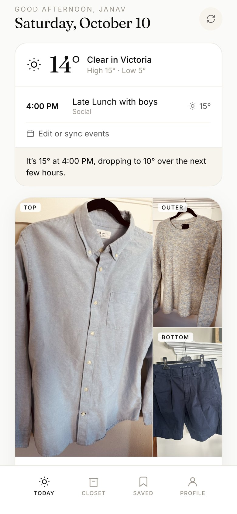
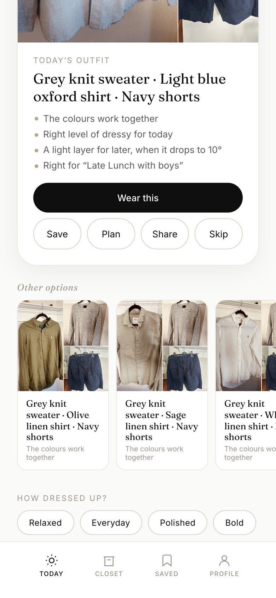
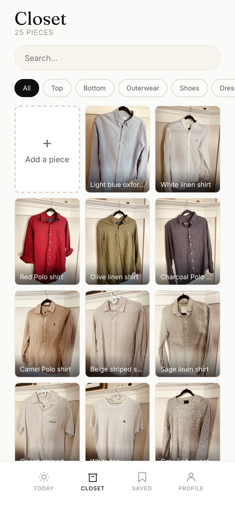

# EDIT: Daily Style

**One outfit a day, picked from your own closet, for the weather where you are and what's on your calendar.**

Live: **https://edit-daily-style.netlify.app**

<p>
  
  
  
</p>

*A real day: Saturday 10 October in Victoria, BC, with a 4 PM lunch. It's 15° at the start and drops to 10° over the next few hours. From my 25-piece closet, EDIT picked a light-blue oxford and navy shorts, with a grey knit as a light layer for later. That's what I wore. (I had hearted the navy shorts; without that, it picked grey shorts and listed this exact outfit second.)*

## What it does

- **Your clothes only.** You photograph and post the clothes you own, and EDIT styles you from them. It never suggests buying anything. When your closet can't cover the day, it says so plainly ("Nothing you own is rated warm enough for 2°…").
- **Reads the weather for the hour you'll be out.** Live forecasts from [Open-Meteo](https://open-meteo.com). EDIT checks the temperature at your event's start time and over the following few hours, so a mild afternoon that turns cold gets a light layer to carry.
- **Reads your calendar.** Sync a Google, iCloud or Outlook calendar link, upload an `.ics` file, or type events in. Event titles become occasions ("Job interview" means dressier; "CSC 503" means a campus day), and back-to-back classes become one outfit.
- **Explains itself.** Every pick comes with plain reasons: *the colours work together*, *right for "Late Lunch with boys"*, *a light layer for later, when it drops to 10°*.
- **Learns from you.** Wearing, saving, skipping and ♥-ing pieces adjusts what it suggests next. Recently worn outfits are held back.
- **Accounts and a shareable closet.** Each closet is private. You can turn on a read-only public link (for example, for a portfolio).

## How it works

```
 Browser (React + Vite)                         Netlify
 ┌──────────────────────────────┐              ┌────────────────────────────┐
 │ Today · Closet · Saved · You │──POST url──▶ │ /functions/ical            │──▶ Google / iCloud /
 │                              │ ◀──.ics───── │  calendar relay (CORS)     │    Outlook calendar
 │ engine/  context → generate  │              │ /functions/keepalive       │
 │          → scoring → limits  │              │  daily ping (cron)         │──┐
 └──────┬───────────────┬───────┘              └────────────────────────────┘  │
        │               │                                                      │
  Open-Meteo        Supabase  ◀────────────────────────────────────────────────┘
  (weather)         Auth · Postgres (profiles, items) · Storage (closet photos)
                    protected by row-level security
```

**The outfit engine** (`src/engine/`) is a set of hand-written rules, not a trained model, so every suggestion can be explained:

1. **Context** (`context.js`): turns calendar events into occasions and a formality range, and turns the forecast at the event's hour into a warmth target. It decides whether you need a coat, a rain layer, or a light layer for later.
2. **Generate** (`generate.js`): builds every top + bottom (or dress) combination from pieces that aren't in the wash, adding shoes, layers and accessories when relevant.
3. **Score** (`scoring.js`): rates each combination on colour harmony, fit balance, formality, warmth, rain readiness, occasion fit, your style references and favourite colours, and what you've loved, worn or skipped.
4. **Limits** (`limits.js`): honest notes about what the closet can't cover, without suggesting purchases.

## Security and privacy

- **Row-level security** on every table and on photo storage: users can only read and change their own profile, clothes and photos. A closet is readable by others only if its owner turns on the public link, and even then it's read-only. [`supabase/tests/rls_test.sql`](supabase/tests/rls_test.sql) checks 18 cases inside a transaction that is always rolled back.
- **Private photo bucket.** Images are served through short-lived signed URLs and resized in the browser before upload.
- **The calendar relay won't act as an open proxy.** It accepts only HTTPS calendar addresses from Google, iCloud and Outlook, and only by POST, so private calendar links never appear in URLs or server logs.
- Only the publishable Supabase key ships to the browser. Saved outfits, calendar events and learned preferences stay on the device, scoped per account.

## Testing

```bash
npm test            # 345 tests
npm run coverage    # engine 99%, calendar parser + serverless functions 100%
npm run lint
```

The tests cover the scoring rules, calendar parsing (recurring events, time zones, daylight saving changes), weather and geocoding (with mocked network calls), the database mapping layer, and both Netlify functions.

## What broke, and what it taught me

- **The app went blank overnight.** It loaded the newest version of a library on every visit, and a new major release broke it. *Lesson: pin your dependencies.* Later I moved it to a proper build step (Vite) so nothing compiles in the visitor's browser.
- **The browser wouldn't let me read my own calendar.** Google and Apple calendar links block requests from web pages (CORS). I built a small serverless relay and made sure it couldn't be abused as an open proxy.
- **Tests found bugs I'd never have spotted by clicking around.** Events after the clocks changed landed an hour off or on the wrong day. "9:30" sorted after "13:00". My own class, "ECE 569A", wasn't recognised as a class, and a "light blue" shirt had no colour to choose. All of these were fixed, with tests to keep them fixed.
- **A real Saturday showed what the engine was missing.** It was 15° at 4 PM and 10° a few hours later, and the engine only looked at the start time. It now checks the hours after an event and suggests a light layer to carry.

## Running it locally

```bash
npm install
cp .env.example .env.local   # then fill in your Supabase project's URL and publishable key
npm run dev                  # http://localhost:5173
```

To set up the backend, create a Supabase project, then run `supabase link` and `supabase db push` to apply [`supabase/migrations/`](supabase/migrations/). Deploy with `netlify deploy --prod --build`, and set the same two `VITE_SUPABASE_*` variables in Netlify.

## Built with

React 18 · Vite · Supabase (Auth, Postgres, Storage, row-level security) · Netlify (hosting, Functions, scheduled functions) · Open-Meteo · iCalendar (RFC 5545) parsing · Vitest · ESLint

---

[`docs/original-plan.md`](docs/original-plan.md) is the first design spec, written before building. The shipped version differs (a web app with Supabase rather than React Native with Express), and that difference is part of the story.
